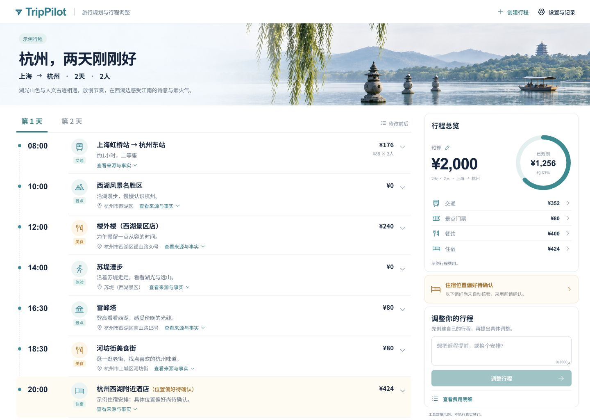
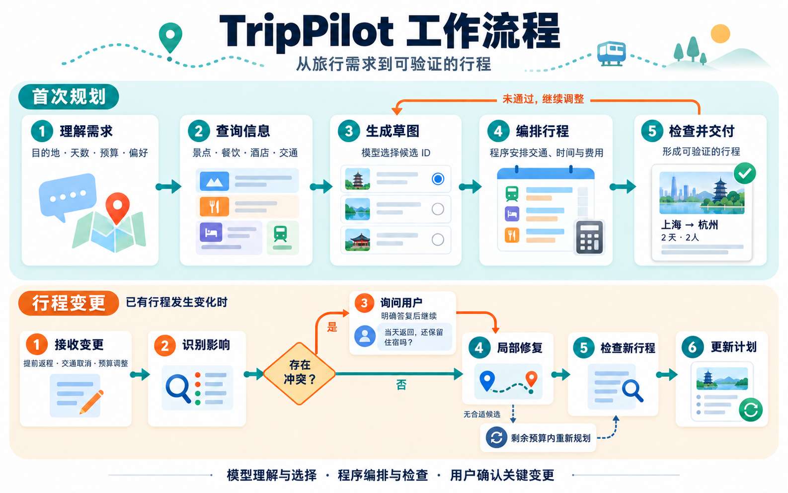

# TripPilot

**Travel planning with tool-grounded itineraries and incremental revision.**

[](pyproject.toml)
[](uv.lock)
[](LICENSE)
[](https://github.com/Wisnflo/TripPilot/actions/workflows/ci.yml)

TripPilot 是一个面向多约束旅行任务的 Agent：理解自然语言需求，查询工具事实，生成可验证的行程；当返程时间、交通或预算变化时，优先修复受影响的安排，遇到冲突则先澄清，再提交新的计划版本。

[快速开始](#快速开始) · [架构设计](docs/architecture.md) · [评测与复现](docs/evaluation.md) · [结果数据](evaluation/results.json)

## 核心能力

- **事实驱动的规划**：模型提取带原文证据的需求、选择公开候选 ID；编译器负责复制价格等事实、连接交通、安排时间并计算费用。
- **局部修复与修改记录**：将需求变化转为结构化事件，核对计划版本，通过检查后提交修改，并保留未受影响的安排。
- **明确的冲突澄清**：例如“改为当天返回”与原住宿要求冲突时，生成可恢复的提问状态，由用户选择取消住宿或保留原计划。
- **执行时限与资源控制**：规划、修复和模型回退共享预算；进程组监督提供任务总时限，主动取消会清理子进程与待执行任务。
- **可审计的评测与用量**：逐请求记录尝试、延迟、模型标识、token 和缓存用量；运行时工具事实与离线评分标注分离。

## 评测结果

在 ChinaTravel 旅行环境中，首次规划覆盖 **200 个独立父任务**，动态修复覆盖 **56 个父任务上的 100 个可行事件**。主要对照为 ReAct + 运行时检查器（`b2`）；所有失败和超时均保留在分母。

| 任务 | TripPilot | ReAct + 检查器 | 已返回 token 减少 | 累计任务耗时减少 |
| --- | ---: | ---: | ---: | ---: |
| 首次规划：200 个父任务 | **142/200（71.0%）** | 55/200（27.5%） | **74.8%** | **41.4%** |
| 条件修复：100 个事件 | 85/100（85.0%） | **88/100（88.0%）** | **43.2%** | **45.2%** |

首次规划的配对通过率提高 **43.5 个百分点**，95% 父任务重采样区间为 35.5–51.0 个百分点。单次生成与 ReAct 的完整通过分别为 6/200、29/200。四种方法使用相同公开信息包和资源上限；TripPilot 的后端工具查询更多，收益体现本次共同 360 秒预算内的系统表现。

动态修复的完整通过率为85.0%，对照为88.0%；主要收益在用量、耗时和原安排保留。双方共同成功的 **80 个事件**中，TripPilot 已返回 token 为 1.44M（对照 4.60M），累计耗时 1,871.63 秒（对照 6,308.89 秒）；同一 334 条未受影响活动分别保留 **329 / 203** 条，改动 **501 / 882** 项。66 个事件由确定性快路径零模型调用完成，其收益来自程序化候选修复。

动态修复从相同的有效行程出发，统计需求变化后的修复成功率。模型服务、执行预算和用量口径，以及组件、重复运行和第二模型结果，见[评测与复现](docs/evaluation.md)。

## 交互工作台



按天浏览行程，展开活动来源和费用；预算与偏好提示集中在右侧，修改前后可直接对照。首屏为明确标注的界面示例；真实生成、执行记录与示例回放分别展示。桌面、平板和手机均可使用。

## 工作流程



模型负责语言理解与候选选择，程序负责可确定的事实处理和执行约束。在限定候选中未找到方案时，系统会尝试回退策略或结束本次任务。

## 快速开始

### 1. 安装

需要 [uv](https://docs.astral.sh/uv/) 与 Python 3.12。本仓库包含运行和离线验证所需的工具数据表与任务数据，无需为体验下载完整上游项目。

```sh
git clone https://github.com/Wisnflo/TripPilot.git
cd TripPilot
uv sync --locked
cp .env.example .env
```

在 `.env` 中填写 OpenAI-compatible API 的 `OPENAI_API_KEY`、`OPENAI_BASE_URL`。模型通过命令行显式指定：

```sh
export MODEL_ID="qwen3.8-reasoner"  # 替换为当前服务可用的模型标识
```

### 2. 打开本地工作台

```sh
uv run --locked python scripts/demo.py --port 8765
```

打开 `http://127.0.0.1:8765/`。页面支持创建行程、修改要求和冲突确认，并展示费用、来源与修改前后对比。三个示例回放无需 API；实时生成使用本机配置的模型，可在“设置与记录”中选择服务可用的模型标识。Python 启动器直接提供已构建的页面，无需安装 Node.js。前端开发见 [frontend](frontend/README.md)。

### 3. 生成行程

```sh
uv run --locked python scripts/trip.py plan \
  --from-city 上海 --to-city 杭州 --days 2 --people 2 \
  --request "预算2000元，想去公园散步，住一间双床房" \
  --model "$MODEL_ID" --output-dir output/trip-first
```

成功后生成 `plan.json`、`task.json` 和 `record.json`。每次指定新的输出目录，避免覆盖现有计划。

### 4. 修改并澄清

```sh
uv run --locked python scripts/trip.py revise \
  --task output/trip-first/task.json --seed output/trip-first/plan.json \
  --change "提前一天回去" --model "$MODEL_ID" \
  --output-dir output/trip-change
```

若返回 `needs_clarification`，读取问题与选项，再明确答复：

```sh
uv run --locked python scripts/trip.py answer \
  --state output/trip-change/state.json --answer cancel_overnight \
  --model "$MODEL_ID" --output-dir output/trip-confirmed
```

`cancel_overnight` 表示取消住宿要求；`keep_original` 表示保留原行程。回答前会核对澄清状态与种子版本。仅在生成了待答复状态时运行 `answer`。

### 5. 验证与复现

以下检查不调用收费模型：

```sh
uv run --locked python -m unittest discover -s tests -q
uv run --locked python scripts/check_isolation.py
uv run --locked python scripts/verify_release.py
```

完整对照会调用模型；配置和断点恢复步骤见[评测与复现](docs/evaluation.md)。

## 项目结构

```text
src/trippilot/
├── planning/       # 条件提取、候选选择与草图编译
├── repair/         # 变更理解、澄清、事务编辑与增量修复
├── execution/      # 进程监督、取消与请求账本
├── agent/          # ReAct 循环与轨迹
├── tools/          # 只读工具白名单与双语实体链接
├── plan/           # 结构、事实与时间检查
├── models/         # API 配置、超时和重试
└── web/            # 本地交互工作台
frontend/           # React 页面源码、依赖锁文件与构建工具
scripts/            # 产品 CLI、评测运行与独立判分
tests/              # 输入、规划、事务、澄清、超时与计费测试
evaluation/         # 协议、逐任务结果、请求账本与校验清单
data/               # 公开输入与仅供离线评分的标注
upstream/ChinaTravel/ # 保留归属的第三方环境与配套数据
```

## 运行边界

- 使用 ChinaTravel 示例数据，覆盖北京、上海、南京、杭州、苏州、深圳、成都、武汉、广州、重庆 10 座城市；不执行真实预订，也不提供实时营业或交通保证。
- `checked_ok` 表示公开运行时检查通过；完整 benchmark 约束由离线评分器独立判定。
- 执行 Agent 使用 macOS 文件访问策略或 Linux Landlock（ABI ≥ 3）。代码与工具事实只读，任务目录可写；不支持的系统会拒绝执行。网络仍用于模型 API，该边界不用于运行任意第三方代码。
- 首次规划默认 360 秒，修复默认 240 秒；每请求 90 秒、最多 2 次尝试，最多 16 次逻辑模型调用。取消会终止本地任务，模型服务的实际计费以服务方账单为准。
- API费用按已返回用量和 `config/v3-pricing.json` 中的单价估算；缺失用量单独标记。更换模型服务时请更新单价，实际支出以服务方账单为准。

## 许可证与致谢

TripPilot 原创代码采用 [MIT](LICENSE)。第三方 ChinaTravel 代码保留其 [MIT 许可证](upstream/ChinaTravel/LICENSE)；查询与 sandbox 数据采用 **CC BY 4.0**。

工具环境、配套数据与原始评分器来自 [LAMDA-NeSy/ChinaTravel](https://github.com/LAMDA-NeSy/ChinaTravel)。数据来源、版本、修改范围与引用方式见 [THIRD_PARTY_NOTICES](THIRD_PARTY_NOTICES.md)。
